# Digital8 — レトロPC風画像変換器

ローカル完結のレトロPC風画像変換器です。PC-8801mk2風、PC-9801VM21以降風の画像に変換します。

## 現行版：PC-8801 / PC-9801 統合版

V2「頻出パターン式」とV4「2色パターン式」を選べる統合版を開発・更新しています。機種別の旧版は開発終了とし、比較用の履歴として残しています。

- [統合版を起動する](distribution/Digital8_V2_V4/README.md) — `distribution/Digital8_V2_V4/`で依存ライブラリを入れ、`起動_GUI.bat`を実行
- [使い方と画面写真](distribution/Digital8_V2_V4/使い方.md)
- [入力・PC-8801・PC-9801の変換例](distribution/Digital8_V2_V4/サンプル.md)

| 入力画像 | 統合版・PC-8801出力例 | 統合版・PC-9801出力例 |
| --- | --- | --- |
|  | 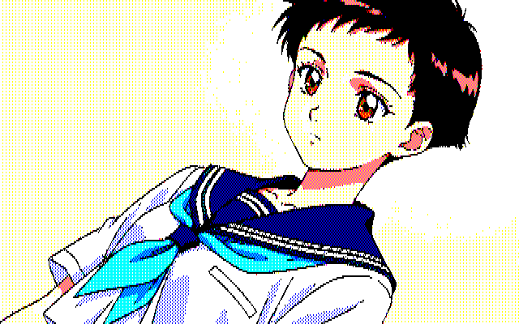 |  |

この公開版には、実行に必要なソース・固定パレット・文書と、展示用の変換例を収録しています。開発時の解析資料や資料由来の参照PNGは含めません。

## 旧版（開発終了）

以前の機種別V1・V2と解析資料を残しています。以下は旧版の説明と変換例です。

- `PC-8801/`: [旧版の使い方](PC-8801/使い方.md)、[技術解説](PC-8801/技術解説.md)
- `PC-9801/`: [旧版の使い方](PC-9801/使い方.md)、[技術解説](PC-9801/技術解説.md)
- `distribution/PC-8801_Digital8_V1/`、`distribution/PC-8801_Digital8_V2/`
- `distribution/PC-9801_16color_V1/`、`distribution/PC-9801_16color_V2/`

V2の設計とV1との差は `EXPERIMENT_V2.md` を参照してください。

## 旧版V2の変換例

各行は左が入力画像、右がV2での変換結果です。PC-9801版の番号は変換時に選んだ固定パレットを示します。結果は入力画像や設定によって変わります。

### PC-8801・デジタル8色（7例）

| 入力画像 | PC-8801 V2 |
| --- | --- |
| 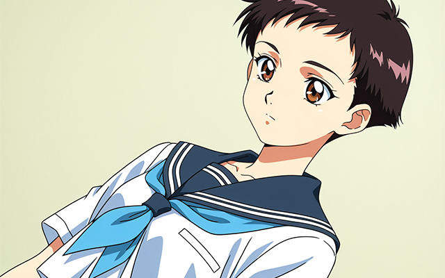 |  |
|  | 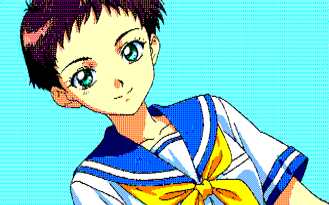 |
|  | 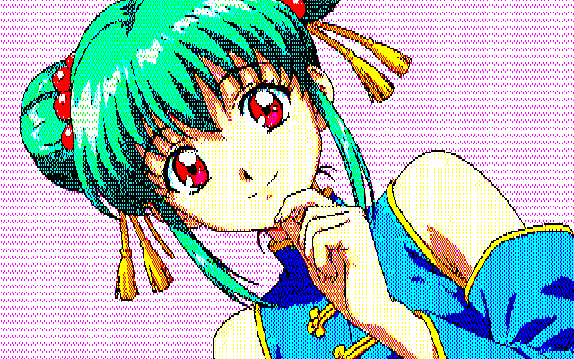 |
|  | 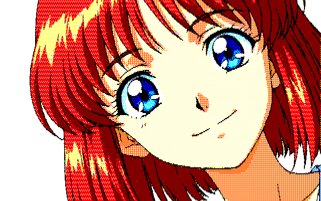 |
| 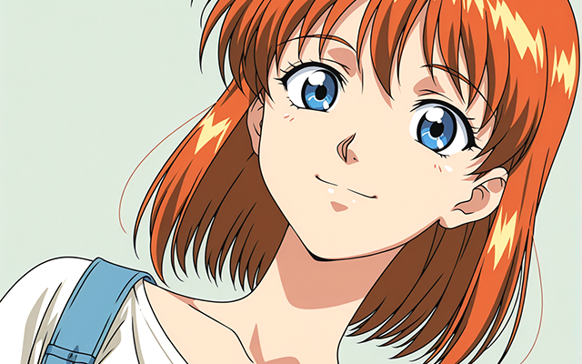 | 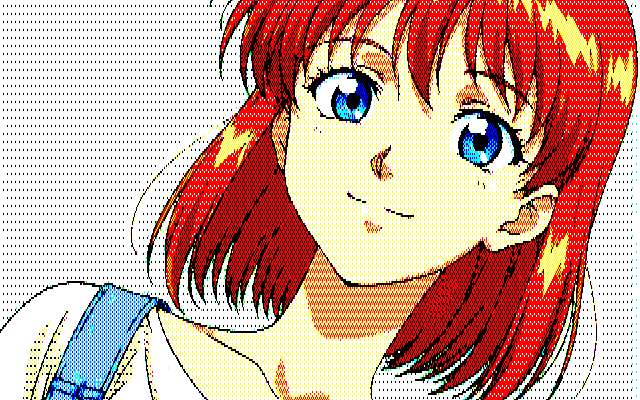 |
|  | 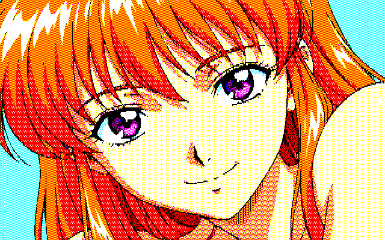 |
|  | 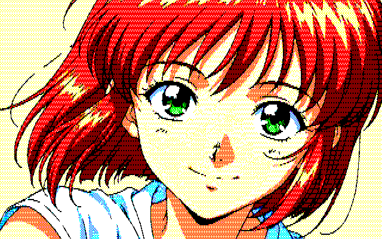 |

### PC-9801・4096色中16色（7例）

| 入力画像 | PC-9801 V2 |
| --- | --- |
|  | 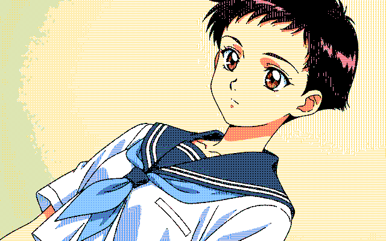<br>パレット01 |
|  | 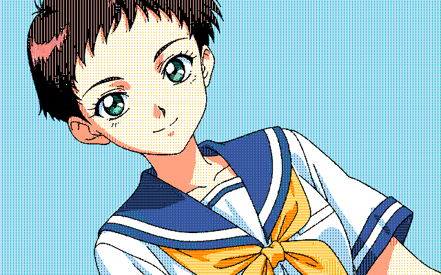<br>パレット02 |
|  | <br>パレット02 |
|  | 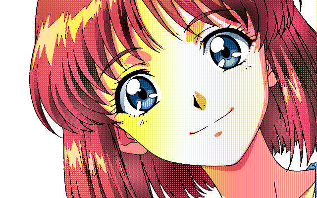<br>パレット05 |
|  | 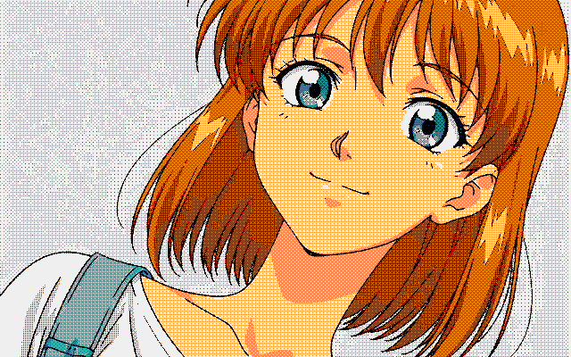<br>パレット08 |
|  | 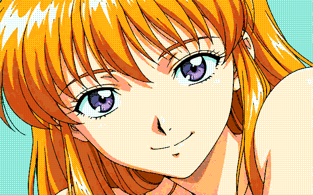<br>パレット02 |
| 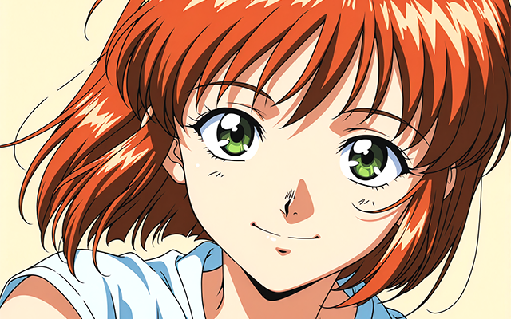 | 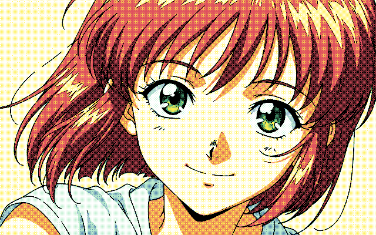<br>パレット05 |

両機種のV1・V2とも、R/G/B、彩度、明度、コントラストをGUIで調整できます。
各スライダーの右側では数値を直接入力できます。色調整の結果は入力プレビューへリアルタイムに反映され、そのまま変換処理にも使われます。
「入力を横幅640pxへ縮小」を有効にすると、幅640pxを超える画像を縦横比を保って縮小してから色調整・変換します。幅640px以下の画像は拡大しません。
縮小処理には既存依存のPillowによるLANCZOSリサンプリングを使用します（Pillow: MIT-CMU License）。

各配布フォルダで、初回だけ次を実行してください。

```powershell
python -m pip install -r requirements.txt
```

その後、V1は `起動_GUI_V1.bat`、V2は `起動_GUI_V2.bat` を実行します。

## License

This project is released under the [MIT License](LICENSE).

変換例の画像は動作例の表示用であり、ソフトウェア本体のMITライセンスの対象外です。画像の権利は各権利者に帰属します。
