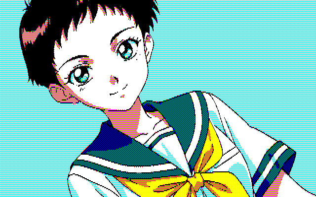
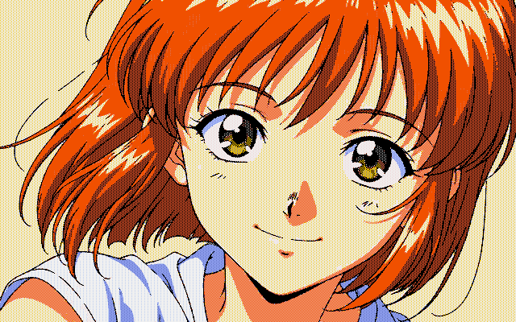

# 変換サンプル

`output_sample/変換元`の7枚に対し、PC-8801とPC-9801の出力例を並べました。画像をクリックすると元の640×400 PNGを開けます。サンプルのファイル名は作成時のままです。現在のGUIで新しく保存すると、出力名には選択したパレット名が付きます。

| 変換元 | PC-8801出力例 | PC-9801出力例 |
| --- | --- | --- |
|  |  |  01 Dovema |
|  |  |  01 Dovema |
|  |  |  05 Dukena |
|  |  |  05 Dukena |
|  |  |  09 Silven |
|  |  |  11 Camuri |
|  |  |  12 Camura |

## PC-8801: Dinsorパレットとの比較

同じ変換元のデジタル8色版とDinsor版です。

| 変換元 | デジタル8色 | Dinsor |
| --- | --- | --- |
|  |  |  |
